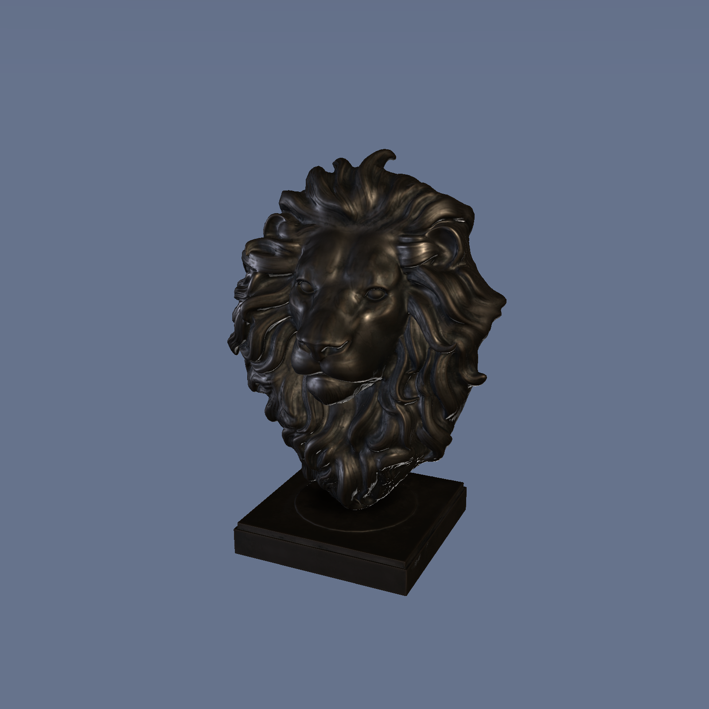
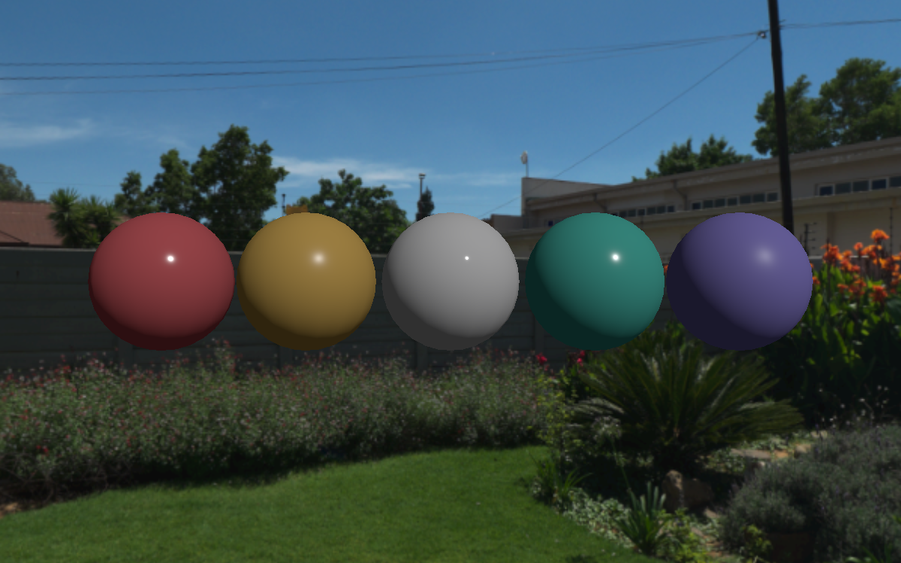
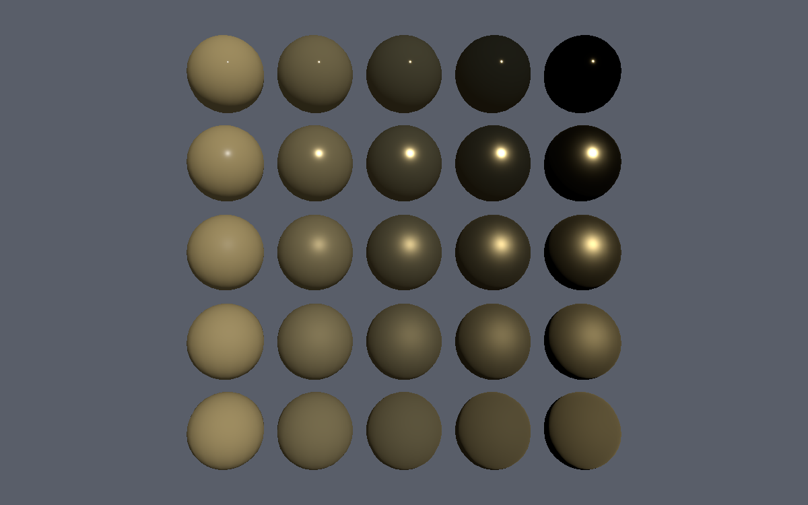
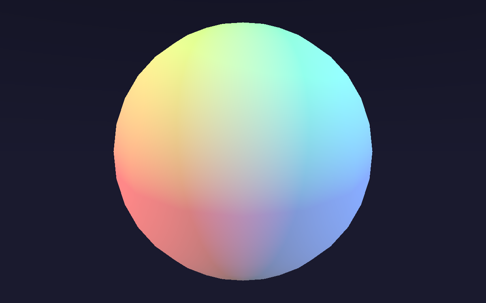
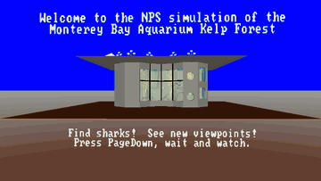

# x3d-cpp

A C++20 headless X3D runtime SDK. Parse XML, ClassicVRML, VRML97, or JSON,
advance scene behavior, and extract meshes, materials, lights, and cameras for
an application renderer. The node bindings are generated from the X3D 4.0
Unified Object Model. Behavioral conformance is tracked in the
[findings register](docs/conformance/findings.yaml).

The [SDK reference](docs/sdk/) describes the public surface. Start with the
[native host contract](docs/wiki/guides/native-host.md) when integrating a
renderer or an application event loop.

## Gallery — real X3D, rendered headless

The [CPU rasterizer example](examples/cpu_raster/) produces these images.

| | |
|---|---|
|  |  |
| [CC0 lion model](https://polyhaven.com/a/lion_head) | PhysicalMaterial and Background |
|  |  |

### Animated — interpolators over time

The CPU example steps the scene clock with `--animate`; ffmpeg encodes the frames.



The [Kelp Forest example](examples/cpu_raster/assets/kelp_flythrough/) uses the
NPS/MOVES exhibit, fetched separately with attribution. See the
[animation demos](examples/cpu_raster/README.md#animation-demos) for reproduction.

## Supported platforms & versions

The [CI workflow](.github/workflows/ci.yml) defines compiler and platform checks.
The CMake package requires C++20 and CMake 3.21 or later.

Readers accept X3D 3.0–4.1 version declarations; the generated node model is 4.0.
Loading a newer version declaration does not add its node types. The XML reader
keeps unknown elements as opaque content, so XML to XML conversion preserves them. See the
[parse readers](docs/wiki/subsystems/parse-readers.md) for version handling.

## Build and install

Requires a C++20 compiler and CMake 3.21+. Build from the checkout:

```bash
cmake -S . -B build -G Ninja \
  -DCMAKE_BUILD_TYPE=Release \
  -DX3D_CPP_BUILD_TESTS=OFF
cmake --build build --parallel 2
cmake --install build --prefix "$PWD/install"
```

Use `RelWithDebInfo` instead of `Release` when you need debug information.
The default package builds shared node and runtime libraries. Set
`X3D_CPP_SHARED_NODES=OFF` for static libraries.

Consume the installed package from a downstream CMake project:

```cmake
find_package(x3d_cpp CONFIG REQUIRED)
target_link_libraries(my_app PRIVATE x3d_cpp::sdk)
```

Configure that project with `-DCMAKE_PREFIX_PATH=/path/to/install`.
The [minimal embedder](examples/embed_minimal/) is a runnable installed-package
consumer.

The default SDK build uses sources in the checkout. Optional backends and the
OpenGL example can fetch dependencies during configuration; see
[backend configuration](cmake/x3d/backends.cmake) and the
[OpenGL build instructions](examples/poc_renderer/README.md#build).

## Quickstart — three ways in

### 1. The `x3d` CLI (no code)

The top-level build produces `build/x3d`:

```bash
build/x3d convert scene.x3dv -o scene.x3d -f xml
build/x3d validate scene.x3d --json
build/x3d sim scene.x3d --ticks 120
build/x3d extract scene.x3d -o scene.stl
build/x3d extract scene.x3d -o scene.glb
build/x3d canonicalize scene.x3d
```

See the [CLI reference](docs/wiki/subsystems/cli-suite.md) for options and
output contracts.

### 2. Embed the SDK (one header)

Include `x3d/sdk.hpp` and link `x3d_cpp::sdk`. A `RuntimeSession` owns the
document, execution context, and extractor:

```cpp
#include "x3d/sdk.hpp"
namespace sdk = x3d::sdk;

auto session = sdk::RuntimeSession::create(sdk::parseFile("scene.x3d"));
auto initial = session->fullSnapshot();
for (auto id : initial.added) {
    const auto &item = session->extractor().item(id);
    // Upload *item.mesh, item.worldTransform, and item.material to your renderer.
}

// In the application frame loop:
session->tick(now); // monotonic seconds in the application's chosen time origin
auto changes = session->delta();
// Apply added/removed items and the advertised update channels.
```

For complete programs, see [embed_minimal](examples/embed_minimal/).
To build a scene in code, use `SceneBuilder`. It places each child in the field
its type belongs in and throws on a field, value or ROUTE that cannot be right:

```cpp
#include "x3d/authoring.hpp" // or x3d/sdk.hpp (sdk::SceneBuilder)

x3d::authoring::SceneBuilder scene;
auto spin = scene.add<x3d::nodes::Transform>().def("Spin");
spin.add<x3d::nodes::Shape>().add<x3d::nodes::Sphere>().set("radius", "2");
auto clock = scene.add<x3d::nodes::TimeSensor>().set("loop", "true");
auto turn = scene.add("OrientationInterpolator")
                .set("key", "0 1").set("keyValue", "0 1 0 0  0 1 0 3.14");
scene.route(clock, "fraction_changed", turn, "set_fraction");
scene.route(turn, "value_changed", spin, "rotation");
std::cout << x3d::authoring::XmlWriter{}.writeDocument(scene.document());
```

`x3d/authoring.hpp` with `x3d_cpp::authoring` is the slim target for this: no
parser, simulation or extraction.

Simulation and extraction use host-supplied resource callbacks. `parseFile`
and the default Inline/EXTERNPROTO resolvers read local files; inject both
parse resolvers when the host must control recursive loading. See
[asset loading](docs/wiki/subsystems/parse-readers.md#recursive-asset-loader-policy).

### 3. Render it headless (the gallery above)

Build the CPU example and render a scene:

```bash
mise run cpuraster
build-cpuraster/examples/cpu_raster/x3d_cpu_raster scene.x3d -o scene.png
```

### 4. Drive a scene through the SAI

[`sai/`](sai/README.md) is a portable C++20 Scene Access Interface: one
`provider::service` contract with a reference backend, and a
[native backend](adapters/sai_provider/README.md) that runs this runtime. Try
it with `mise run sai-hello`, see the [headless SAI host](examples/sai_host/),
or start from the [SAI documentation](docs/wiki/sai/index.md).

## Generating the C++ bindings

Bindings are committed; consumers do not need the generator. To regenerate:

```bash
uv run x3d-cpp-gen --out generated_cpp_bindings
```

See the [generator reference](docs/wiki/subsystems/generator.md) for its API
and `uv run x3d-cpp-gen --help` for command options.

## Dev tasks (mise)

Run `mise tasks` for the task catalog maintained in [mise.toml](mise.toml).

## Golden-file policy

Generated node headers and definitions are committed. After an emitter or
template change, regenerate and review the generated diff. The golden check
compares regeneration with the committed tree; see
[ADR-0005](docs/wiki/decisions/0005-golden-files-in-git.md).

## CI

The [workflow](.github/workflows/ci.yml) defines the checks and their triggers.

## Configuration (optional external resources)

The [developer guides](docs/wiki/guides/gate-system.md) describe external inputs
used by validation tools. Resource callbacks used by applications are described
in the [subsystem references](docs/wiki/subsystems/sdk-facade.md).

## Test corpus

Fetch the corpus before running corpus regression checks:

```bash
mise run corpus-fetch
mise run cli-gate-regression
```

`X3D_CORPUS_DIR` selects another corpus root. The fetcher defaults to
`.x3d-corpus/`, including the selected scenes' Inline/EXTERNPROTO dependencies.
See [scripts/fetch_corpus.sh](scripts/fetch_corpus.sh) for the source and layout.

## License

[MIT](LICENSE) © 2026 Ben Sandbrook. Third-party components and model sources
are credited in [NOTICE](NOTICE).
