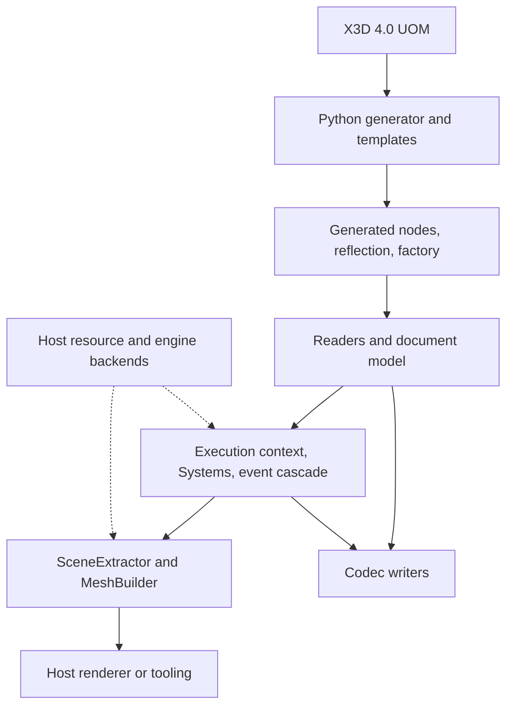

# Architecture

x3d-cpp separates the generated node model, runtime execution, and render-feed
extraction. The core SDK has no renderer. Resource loading and decoding use
host-supplied callbacks; parsing can read local files through `parseFile` and
the default Inline/EXTERNPROTO resolvers.

## Generator and compiled layers

`src/x3d_cpp_gen/` reads the vendored UOM and renders committed C++ node and
reflection sources under `generated_cpp_bindings/`. The
[generator page](../reference/subsystems/generator.md) owns the pipeline details;
[Golden regeneration](../how-to/regenerate-goldens.md) owns the update procedure.
The golden comparison checks generated source bytes, not scene serialization.

Generated definitions, codec writers, parsers, and mesh construction compile
into libraries. [Build and mise](../reference/build-and-tasks.md#compiled-libraries)
describes their targets and shared/static configuration.

## Scene execution

The document model retains nodes, DEF/USE identity, ROUTEs, declarations, and
source metadata. `X3DExecutionContext` builds the scene indices and route graph.
`System` implementations register behavior through `addSystem`; ScriptSystem
also registers post-cascade hooks.

What a tick does, and why the host drives it, is in
[The tick model](tick-model.md). Field writes update node values through
reflection or the scene-owned author field store; transforms, bounds and
extraction caches live in side tables.
Raw generated setters bypass the context's dirty tracking.

See [Execution context](../reference/subsystems/execution-context.md),
[Event cascade](../reference/subsystems/event-cascade.md), and
[Scene graph](../reference/subsystems/scene-graph.md) for their contracts.

## Extraction and serialization

`SceneExtractor` produces an initial snapshot and subsequent `RenderDelta`
changes. Placement identity and world transforms are per path. Shared mesh
payloads let several placements reuse geometry. Consumers own rendering and
resource upload. [Extraction pipeline](../reference/subsystems/extract.md) owns the incremental
contract; [Native host integration](../reference/native-host-contract.md) covers consumption
and lifetime.

Writers serialize the document model through reflection. XML and canonical XML
share semantic graph construction in `runtime/codecs/XmlGraphBuilder.cpp` and
use separate rendering policies. Cross-encoding fidelity depends on the source
and destination grammars; generated-source parity does not prove byte-identical
scene round trips. See [Codec writers](../reference/subsystems/codecs-writers.md) and
[Canonical XML](../reference/subsystems/canonical-xml.md).

## Host boundary

`include/x3d/sdk.hpp` re-exports the curated API. `RuntimeSession` owns a document,
context, and extractor in dependency order. The host supplies time and input,
consumes deltas, and wires optional resources and engines. The
[seam matrix](../reference/seam-matrix.md) lists implementations and contract tests;
[Seams, ports and backends](seams.md) explains the split.

Foreign-format and binary-geometry extensions live under `runtime/ext/` behind
`X3D_CPP_BUILD_EXT`. Core code does not include that layer. The dependency rule
is recorded in [ADR-0001](decisions/0001-ext-firewall.md).

## Floating-point reproducibility

Do not assume bit-identical runtime results across compilers, architectures,
backend choices, or operating systems. Scene math uses floating-point values;
the build does not impose a global no-contraction policy. Use explicit numeric
tolerances for cross-platform behavior tests. Physics has additional host
fingerprint constraints in [ADR-0019](decisions/0019-physics-seam.md).
